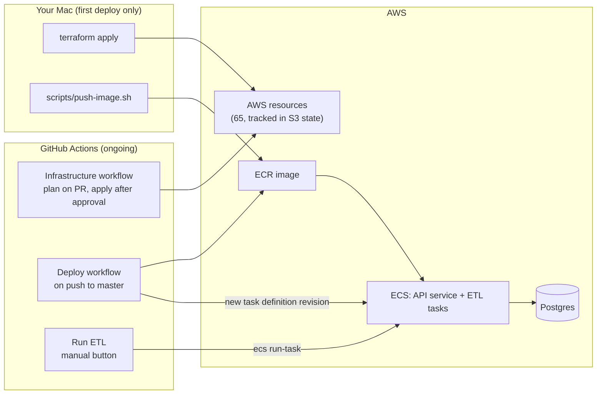
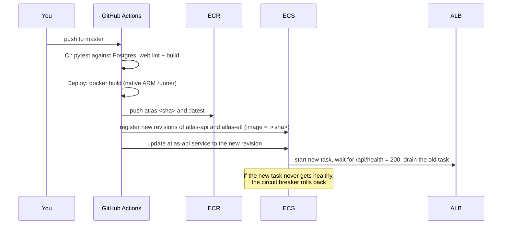

# How Atlas deploys

This walks through what happens, in order, when Atlas is deployed to AWS: what is created, by
what, from where, and what each step depends on. For the copy-paste commands, see
[README → Deploying to AWS](../README.md#deploying-to-aws).

## Who does what

Four kinds of things get deployed, each from a different place:

| What | Source of truth | Built / applied by | Lands in |
| --- | --- | --- | --- |
| **Infrastructure** (network, database, servers, roles…) | `infra/*.tf` + `infra/production.tfvars` | Terraform: from your Mac the first time, then the *Infrastructure* GitHub workflow | AWS (us-east-1) |
| **The application image** (API, ETL, and the built web app) | `Dockerfile`, `src/`, `web/`, `ontology/` | `docker build`: from your Mac the first time (`scripts/push-image.sh`), then the *Deploy* workflow | ECR (container registry) |
| **Secrets** | generated by Terraform (`random_password`), except the FIRMS key | Terraform; the FIRMS key by you (`put-secret-value`) | Secrets Manager |
| **Data** (quakes, alerts, fires, counties, facilities) | the public internet (USGS, NWS, NASA FIRMS, Census, Geofabrik) | the ETL task, run by *Run ETL* or `scripts/run-etl.sh` | the ETL server's disk → Postgres |

Terraform never builds the image or loads data, and the app never creates infrastructure. Each
moving part has exactly one owner.

## Phase 0: before Terraform can run (once)

| # | Step | Where | What happens |
| --- | --- | --- | --- |
| 0.1 | `aws sso login` | Mac | Your browser login gives the CLI and Terraform short-lived credentials for account 765386647622 (role AdministratorAccess). Everything below acts as you. |
| 0.2 | `scripts/bootstrap-state.sh` | Mac → S3 | Creates `s3://atlas-tfstate-765386647622` (versioned, encrypted, private) and writes `infra/backend.hcl`. *Done already.* |
| 0.3 | `terraform init -backend-config=backend.hcl` | Mac | Downloads the `aws` and `random` providers, checks them against `.terraform.lock.hcl`, and connects to the S3 state. Creates nothing in AWS. |

The state bucket can't be managed by the Terraform that stores its state in it, which is why a
script creates it.

## Phase 1: `terraform apply` (once from your Mac, ~15 minutes)

1. **Refresh and plan.** Terraform reads `infra/*.tf` and `production.tfvars`, reads the S3 state
   (empty the first time), and asks AWS read-only questions: availability zones, the latest
   ARM64 ECS server image, CloudFront's address list, and so on. It prints the plan
   (65 to add) and waits for `yes`.
2. **Lock.** It writes a lock file next to the state in S3, so no second run (e.g. GitHub) can
   start mid-apply.
3. **Create, in dependency order.** No step order is written anywhere. Terraform derives it
   from which resource references which (`terraform graph` prints it). Independent resources
   are created in parallel; each one starts as soon as everything it references exists. The
   waves below are that graph for our files.
4. **Save state.** After each resource is created, its real AWS ID is recorded in the state
   file. If the apply fails halfway, everything already created is recorded, and re-running
   `apply` continues from there.
5. **Print outputs**: the site URL, ECR repository, and the GitHub role ARNs.

### The creation waves

| Wave | Created | Waits on | Time |
| --- | --- | --- | --- |
| **1** | VPC · ECR repository · ECS cluster · 2 log groups · SNS alarm topic · 4 secret *containers* (empty) · 3 random passwords (generated locally, never shown) · IAM roles (task execution, task, ETL server) · GitHub OIDC provider · CloudFront request policy | nothing | seconds |
| **2** | 4 subnets (2 public, 2 private) · internet gateway · ALB and ETL security groups · target group · ECR cleanup rule · IAM policies (incl. "may read these 4 secrets") · ETL instance profile · **API and ETL task definitions** · GitHub deploy, plan and apply roles · reader-password secret value · email subscription · ETL-failure log filter and alarm | the VPC, roles, secrets, log groups | seconds |
| **3** | public route table · API security group · database subnet group · **load balancer** · ETL launch template | subnets, gateway, ALB security group, instance profile | ALB ~2–3 min |
| **4** | route table associations · database security group (open only to API + ETL groups) · HTTP listener (default: 403) · **ETL auto scaling group** (the EC2 server boots, adds swap, joins the ECS cluster) | route table, security groups, ALB, launch template | ~1–2 min |
| **5** | **RDS Postgres** (`db.t4g.micro`, private, encrypted) · listener rule ("forward only with CloudFront's secret header") · ECS capacity provider for the ETL server · **CloudFront distribution** · API 5xx alarm | DB subnet group + security group, listener, ASG, ALB | **RDS ~5–10 min, CloudFront ~5–15 min, in parallel** |
| **6** | the two **database URL secrets** (they embed RDS's address) · cluster capacity providers · **ECS API service** (1 task) · database-storage alarm | RDS, task definition, listener rule | ~1 min |

The longest chain, which sets the total time, is
**VPC → private subnets → DB subnet group → RDS → database URL secrets**. CloudFront builds
alongside it.

Not created by default: the WAF (`waf_enabled = false`) and the ETL schedules
(`sync_schedule`, `facilities_schedule` are `null`). Their blocks use `count`/`for_each` that
evaluate to zero.

### What's running when apply finishes

- The **API service** exists, but its task can't start yet. The task definition points at
  `atlas:latest` in ECR, which is still empty, so ECS keeps retrying the image pull. Expected.
- The **ETL server** is up and registered with the cluster, but idle. No ETL runs until you
  run one.
- **Postgres** is empty: no `ontology` schema yet.
- **CloudFront** serves the URL, but the load balancer has no healthy target, so visitors get a
  503.

## Phase 2: first image, secret and GitHub connection (from your Mac)

| # | Step | From → to | What happens |
| --- | --- | --- | --- |
| 2.1 | FIRMS key: `put-secret-value` | Mac → Secrets Manager | Fills the one secret Terraform left empty, so the key never enters Terraform state. Must happen before any ETL run: ECS won't start a task whose secret has no value. |
| 2.2 | `scripts/push-image.sh` | Mac → ECR | `docker buildx` builds the `runtime` stage for `linux/arm64`: compiles the web app (Node stage), installs Python dependencies with uv, installs osmium-tool, bakes in DuckDB's spatial extension. Pushes it as `:<git sha>` and `:latest`. |
| 2.3 | API starts | ECR → Fargate | ECS's next retry pulls `:latest`. The task reads `ATLAS_READ_ONLY_DATABASE_URL` from Secrets Manager, starts `atlas serve --behind-proxy`, and connects to Postgres. `/api/health` answers **503 "not_indexed"**, so the ALB keeps it out of rotation. Correct: no data yet. |
| 2.4 | `gh variable set …` ×3 | Mac → GitHub | Stores the three role ARNs (deploy, plan, apply). GitHub's workflows stop skipping themselves. |

## Phase 3: first data load (GitHub or Mac)

**Run ETL → `sync`** (or `scripts/run-etl.sh sync`):

1. The runner (or your Mac) calls `ecs run-task` with the `atlas-etl` task definition, on the
   ETL capacity provider, with command `atlas sync`.
2. ECS starts the container on the **ETL EC2 server**, mounting `/var/lib/atlas-data` as `/data`
   and injecting `DATABASE_URL`, `ATLAS_READER_PASSWORD` and `NASA_FIRMS_API_KEY` from Secrets
   Manager.
3. Inside the container (`src/atlas/sync.py`):
   1. **Connectors** download USGS, NWS, FIRMS and Census data into `/data/landing/`.
   2. **Pipelines** rebuild the clean tables in DuckDB (`/data/atlas.duckdb`).
   3. The ontology is **validated** against those tables.
   4. The **indexer** connects to Postgres as the owner:
      1. it creates the `atlas_api` read-only role (first run),
      2. it builds the `ontology_staging` schema, grants it to `atlas_api`, and swaps it live as
         `ontology`;
      3. it records the run in `atlas_meta.sync_runs`.
4. The API's `/api/health` now returns 200 → the ALB marks it healthy → **the site is live** at
   the CloudFront URL.

**Run ETL → `facilities`** (once): `atlas facilities --force && atlas index`. This downloads the
Geofabrik US extract (12 GB, free inbound) to the server's disk, filters it with osmium, and
re-indexes. Afterwards, runs apply only daily changes.

## Ongoing: code changes (push to `master`)

The ETL is **not** run by a deploy. The next ETL run uses the newest `atlas-etl` revision,
which the deploy just registered.

## Ongoing: infrastructure changes (pull request)

1. Edit `infra/` (usually `infra/production.tfvars`) on a branch and open a PR.
2. The **Infrastructure** workflow assumes the **plan role** (read-only), runs
   `terraform plan`, and posts the result as a PR comment.
3. Merge. The **apply** job starts but **waits** in the `production` environment until you
   approve it (Actions → the run → *Review deployments*).
4. After approval it assumes the **apply role**, re-plans, and applies exactly that plan. The
   S3 lock prevents overlapping runs.

### The task definition handoff

Terraform and the Deploy workflow both create task definition revisions:

- **Terraform** owns the *shape*: environment variables, secrets, CPU/memory, command, image
  `:latest`.
- **Deploy** owns the *image*: it copies the latest revision and swaps in `:<sha>`.
- The API service has `ignore_changes = [task_definition]`, so Terraform doesn't roll the
  service back to `:latest` on its next apply.

The consequence: **a Terraform change to the API's task definition** (e.g. a new environment
variable) registers a new revision **but doesn't roll out until the next Deploy**, which builds
on that revision. ETL changes apply on the next ETL run.

## Tearing down

`terraform -chdir=infra destroy` deletes everything in reverse dependency order, roughly the
waves backwards: the service and CloudFront first, then RDS, the network last. RDS is deleted
without a final snapshot (`skip_final_snapshot = true`), and secrets without a recovery window.
The state bucket and the AWS budget are not managed by this Terraform, so they stay; delete them
by hand if you're done for good.

## Where to look when something fails

| Symptom | Likely cause | Look at |
| --- | --- | --- |
| Apply fails partway | quota or permission issue on one resource | the error names the resource; fix it and re-run `apply` |
| API task keeps restarting before 2.2 | no image in ECR yet | expected until the first push |
| Site returns 503 after the image push | no index yet | run ETL `sync` |
| ETL task won't start | FIRMS secret empty, or the ETL server not registered | ECS → cluster `atlas` → tasks (stopped reason) |
| ETL fails | a data source or the database | `aws logs tail /atlas/etl --follow`; `atlas_meta.sync_runs` |
| Deploy rolls back | new API task never got healthy | `aws logs tail /atlas/api --follow` |
